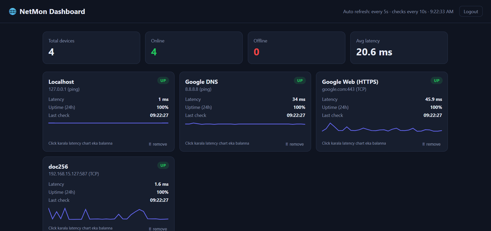

🌐 Network Monitoring Dashboard
A lightweight, real-time network monitoring tool built with Python (Flask), SQLite and Chart.js. It checks devices and services at regular intervals, shows live status on a web dashboard, draws latency charts and sends email alerts when a device goes down or comes back up.

✨ Features
Live dashboard: online/offline counts, average latency, per-device status cards that auto-refresh every 5 seconds
Two check types: ICMP ping (latency) and TCP port check (is a service like HTTP/HTTPS/MySQL actually responding)
Latency charts: click any device to see a 1h / 6h / 24h chart with min/avg/max and failed checks
24h uptime % and sparkline history on every device card
Email alerts (SMTP/Gmail) on DOWN and recovery events
False-alarm protection: a device is marked DOWN only after consecutive failed checks (`FAIL_THRESHOLD`)
Events log: timestamped history of every up/down change
Login system: session-based authentication; all pages and APIs are protected
Add / remove devices from the UI, with input validation to block command injection
Parallel checks using a thread pool; old data auto-cleaned after 7 days
🛠 Tech Stack
Layer	Technology
Backend	Python 3, Flask
Database	SQLite
Frontend	HTML, CSS, JavaScript, Chart.js
Alerts	SMTP (smtplib)
Concepts	ICMP, TCP sockets, multi-threading, REST API, session auth
🚀 Getting Started
```bash
git clone https://github.com/heshanthiprasangika10-debug/Network-Monitoring-Dashboard.git
cd Network-Monitoring-Dashboard

python -m venv .venv
.venv\Scripts\activate          # Windows
# source .venv/bin/activate     # Linux / macOS

pip install -r requirements.txt
```
Set your login (do not keep the defaults), then run:
```bash
# Windows CMD
set ADMIN_USER=youruser
set ADMIN_PASS=your_strong_password
python app.py
```
```powershell
# Windows PowerShell
$env:ADMIN_USER="youruser"
$env:ADMIN_PASS="your_strong_password"
python app.py
```
Open http://127.0.0.1:5000 and log in.
📧 Email Alerts (optional)
Create a Gmail App Password (Google Account → Security → 2-Step Verification → App passwords), then:
```bash
set SMTP_HOST=smtp.gmail.com
set SMTP_PORT=587
set SMTP_USER=youraddress@gmail.com
set SMTP_PASS=your_app_password
set ALERT_TO=where_to_send@gmail.com
```
If these are not set, alerts are printed to the console only.
⚙️ Configuration
Variable	Default	Description
`ADMIN_USER` / `ADMIN_PASS`	`admin` / `admin123`	Login credentials (change them)
`SECRET_KEY`	random per run	Flask session key
`CHECK_INTERVAL`	`10`	Seconds between checks
`FAIL_THRESHOLD`	`2`	Consecutive failures before marking DOWN
🔌 API
All endpoints require login (otherwise `401`).
Method	Endpoint	Description
GET	`/api/devices`	List devices with status, latency, uptime
POST	`/api/devices`	Add a device (`name`, `host`, optional `port`)
DELETE	`/api/devices/<id>`	Remove a device
GET	`/api/devices/<id>/history?hours=1|6|24`	Latency history and summary
GET	`/api/events`	Latest up/down events
🗂 Project Structure
```
├── app.py                 # Flask app, monitor thread, alerts, API, auth
├── requirements.txt
├── templates/
│   ├── index.html         # Dashboard + latency chart
│   └── login.html         # Login page
└── monitor.db             # SQLite database (auto-created)
```
🔒 Security Notes
Hostnames are validated with a strict whitelist regex before being used in checks (prevents command injection).
Login uses constant-time comparison and a short delay on failed attempts.
Credentials and SMTP secrets are read from environment variables, never stored in code.
This uses Flask's development server. Put it behind a production WSGI server (e.g. Waitress/Gunicorn) and HTTPS before exposing it beyond your local network.
🔮 Future Improvements
Multiple users with hashed passwords in the database
SNMP support for routers and switches
Telegram / SMS alerts
Docker support
👩‍💻 Author
Heshanthi Prasangika: HND IT student, SLIATE Labuduwa (ATI Galle)
GitHub · LinkedIn